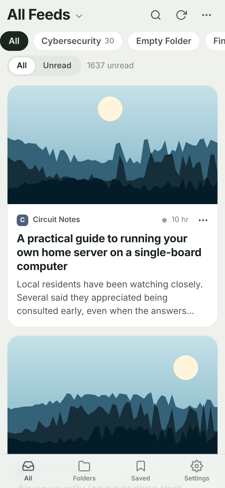
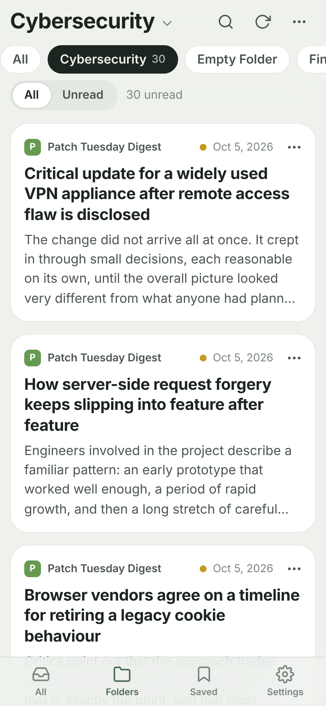
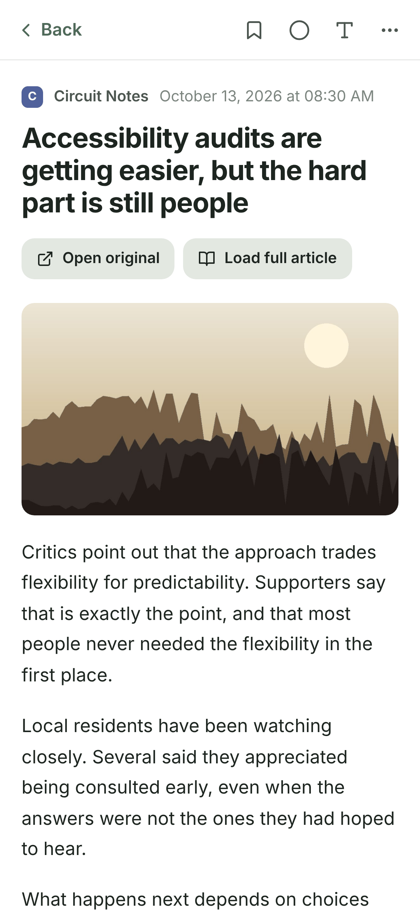
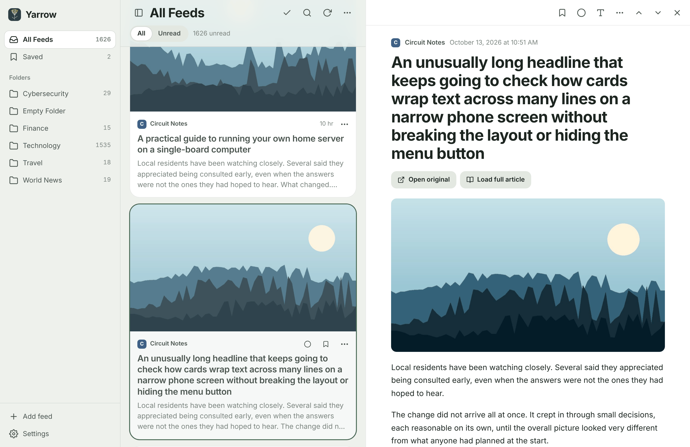

# Yarrow

A calm, self-hosted RSS reader: one chronological, card-based timeline of everything you subscribe to, browsable by folder, that runs as a single small container on a Raspberry Pi.

Yarrow is a fork of [Yarr](https://github.com/nkanaev/yarr) by Nazar Kanaev. It keeps Yarr's Go backend, SQLite storage, feed parser, OPML support and simple menus, and replaces the three-pane interface with a mobile-first scrolling feed inspired by the reading experience of apps like feeeed. It is an original interpretation, using none of feeeed's code, branding or assets.

<p align="center">
  
  
  
</p>
<p align="center">
  
</p>

## What you get

- **One timeline.** All Feeds merges every subscription newest-first (or oldest-first). Switch between all and unread. More articles load as you scroll, with no duplicates.
- **Cards.** Feed name and icon, relative time, headline, a 3–4 line snippet taken from the article itself, and the lead image when there is one. Unread articles carry a small gold dot.
- **Folder-only navigation** (default). Navigate by folders alone; each folder is its own merged timeline. *Expanded* mode lists the feeds inside folders like Yarr; *All feeds* mode hides navigation entirely.
- **Yarr's menus, kept.** Per-article ⋯ menu: mark read/unread, save for later, open original, copy link, share, mark above as read. Per-feed and per-folder menus with Yarr's actions (website, feed link, rename, change link, move to folder, delete).
- **A real desktop web app.** On a MacBook or any window wider than 1200px, articles open in a reading pane beside the timeline, like Mail: the list stays put, the open article is highlighted, `j`/`k` read the next or previous article, space pages through it. Cards show save and mark-read buttons on hover, right-click opens the article menu, the sidebar collapses with `\`. Prefer the full-page reader? Switch it in Settings.
- **A reader that feels native on phones.** Clean typography, sans/serif/mono, text size, "Load full article" for truncated feeds, previous/next, and the back gesture returns you to exactly where you were in the timeline.
- **Installable PWA.** Add to your iPhone home screen. The app shell and recently viewed pages work offline.
- **Private by design.** No analytics, no third-party requests from the app shell, strict Content-Security-Policy, CSRF protection, and an SSRF guard on every outbound fetch.
- **Light on hardware.** ~25 MB RAM idle, one process, SQLite, no Redis or Postgres needed.

Reading state is never changed by scrolling: an article is marked read only when you open it or tell Yarrow to.

## Quick start (Docker Compose)

```sh
git clone <your-fork-url> yarrow && cd yarrow
cp .env.example .env          # optional
docker compose up -d --build
```

Open <http://127.0.0.1:7070> on the same machine. By default the port is bound to `127.0.0.1` only; to reach it from your phone, use [Tailscale Serve](docs/tailscale.md) (recommended) or set `YARROW_BIND=0.0.0.0` and a password in `.env`.

Then add feeds under **Settings → Add feed**, or import an OPML file.

## Guides

| Guide | |
|---|---|
| [Raspberry Pi deployment](docs/raspberry-pi.md) | Install Docker on Raspberry Pi OS (64-bit), build, run, update |
| [Private access with Tailscale](docs/tailscale.md) | HTTPS on your tailnet with `tailscale serve`, no open ports |
| [Moving from Yarr](docs/migrating-from-yarr.md) | Import your existing Yarr database (feeds, folders, read state, starred items, history) and roll back |
| [Backup and restore](docs/backup-restore.md) | Consistent SQLite backups of the Docker volume |
| [Configuration](docs/configuration.md) | Environment variables and command-line flags |
| [Troubleshooting](docs/troubleshooting.md) | Common problems and fixes |
| [Architecture](docs/architecture.md) | Why a fork, what changed, API additions, security model |
| [Testing](docs/testing.md) | What is tested, how to run it, what remains unverified |

## Building from source

Requirements: Go 1.26+, a C compiler (SQLite uses cgo), Node.js 20+.

```sh
make build        # web assets + binary in out/yarrow
make test         # TypeScript typecheck, go vet, Go unit tests
make test-ui      # browser tests with Playwright (pip install playwright)
./out/yarrow -db ./yarrow.db -addr 127.0.0.1:7070
```

Go dependencies are vendored, so builds work offline after `npm ci`.

## Credits and license

MIT licensed; see [LICENSE](LICENSE). Yarrow is built on Yarr © Nazar Kanaev (MIT). Bundled third-party components and their licenses are listed in [docs/attribution.md](docs/attribution.md).
